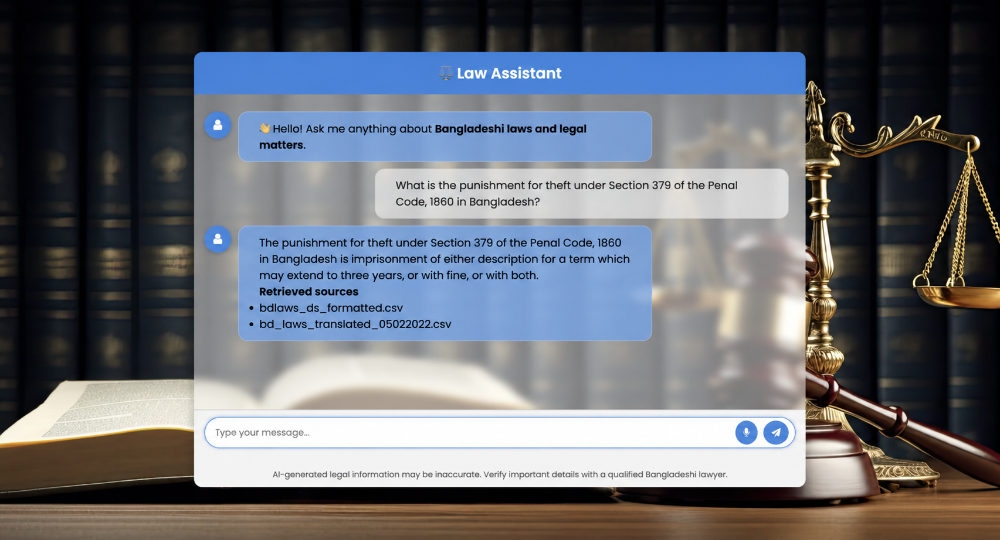
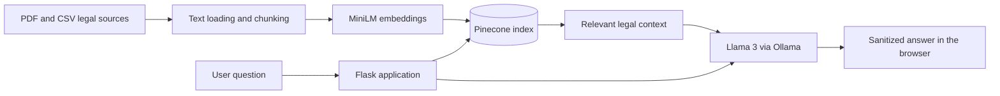

# Bangladesh Law Assistant

[](https://github.com/Abir9795/Law-Assistant/actions/workflows/tests.yml)
[](https://www.python.org/)
[](LICENSE)

A multilingual retrieval-augmented generation (RAG) assistant for exploring
Bangladeshi laws in English, Bangla, and Banglish. It retrieves relevant passages
from a Pinecone vector index and uses a locally running Llama 3 model through
Ollama to produce concise, source-aware responses.

> **Legal disclaimer:** This project provides AI-generated legal information for
> educational purposes only. Responses can be incomplete or inaccurate and are
> not a substitute for advice from a qualified Bangladeshi lawyer.

## Demo



## Highlights

- RAG over Bangladeshi legal PDFs and structured CSV data
- English, Bangla, and Banglish response support
- Local LLM inference with Ollama and Llama 3
- Semantic search using MiniLM embeddings and Pinecone
- Hybrid retrieval that prioritizes exact statutory section matches
- Conversation memory scoped to the browser session
- Browser speech-to-text input where the Web Speech API is available
- Sanitized Markdown rendering and bounded user input/history
- Retrieved filename and page references appended to supported answers
- Reproducible index-building command, tests, and CI

## Architecture



## Technology

- **Backend:** Python, Flask, LangChain
- **Model:** Llama 3 through Ollama
- **Embeddings:** `sentence-transformers/all-MiniLM-L6-v2`
- **Vector database:** Pinecone Serverless
- **Frontend:** HTML, CSS, JavaScript, Marked, DOMPurify
- **Quality:** Pytest, Ruff, GitHub Actions

## Prerequisites

- Python 3.10
- [Ollama](https://ollama.com/) with the `llama3` model
- A Pinecone account and API key
- Conda (recommended) or Python's built-in `venv`

## Local setup

Clone and enter the repository:

```bash
git clone https://github.com/Abir9795/Law-Assistant.git
cd Law-Assistant
```

Create an isolated environment and install the pinned dependencies:

```bash
conda create -n lawbot python=3.10 -y
conda activate lawbot
python -m pip install --upgrade pip
pip install -r requirements.txt
```

Create the local configuration file:

```bash
cp .env.example .env
python -c "import secrets; print(secrets.token_hex(32))"
```

Paste the generated value into `SECRET_KEY` in `.env`, then add your Pinecone API
key. Never commit `.env`.

Download the local model:

```bash
ollama pull llama3
```

If Ollama is not already running, start it in a separate terminal:

```bash
ollama serve
```

## Build the vector index

The app expects a Pinecone index named `lawbot`. Create it and upload the documents
from `Data/` with:

```bash
python store_index.py
```

The upload uses deterministic chunk IDs, so rerunning the command updates the same
chunks instead of creating duplicate IDs. For a different directory or batch size:

```bash
python store_index.py --data-dir Data --batch-size 100
```

If the index already exists and is populated with the same embedding model, this
step can be skipped.

## Run the application

```bash
python app.py
```

Open [http://localhost:8080](http://localhost:8080). A lightweight health check is
available at [http://localhost:8080/health](http://localhost:8080/health).

## Configuration

| Variable | Required | Default | Purpose |
| --- | --- | --- | --- |
| `PINECONE_API_KEY` | Yes | — | Authenticates with Pinecone |
| `PINECONE_INDEX` | No | `lawbot` | Vector index name |
| `PINECONE_CLOUD` | No | `aws` | Cloud used when creating an index |
| `PINECONE_REGION` | No | `us-east-1` | Serverless index region |
| `OLLAMA_MODEL` | No | `llama3` | Local Ollama model |
| `OLLAMA_BASE_URL` | No | `http://localhost:11434` | Ollama server URL |
| `EMBEDDING_MODEL` | No | `all-MiniLM-L6-v2` | Hugging Face embedding model |
| `LEGAL_CSV_PATH` | No | `Data/bdlaws_ds_formatted.csv` | Exact-section lookup corpus |
| `SECRET_KEY` | Recommended | Temporary per run | Signs Flask session cookies |
| `RETRIEVAL_TOP_K` | No | `3` | Number of context chunks retrieved |
| `LOG_CHAT_CONTENT` | No | `false` | Enables potentially sensitive prompt logging |

See [.env.example](.env.example) for all available settings.

## Tests and code quality

Install development tools, then run the same checks used by CI:

```bash
pip install -r requirements-dev.txt
ruff check .
pytest -q
```

The tests mock the external RAG chain, so they do not require Pinecone or Ollama.

## Project structure

```text
Law-Assistant/
├── app.py                  # Flask routes and lazy RAG initialization
├── store_index.py          # Reproducible Pinecone indexing CLI
├── src/
│   ├── helper.py           # Document loading, splitting, and embeddings
│   └── prompt.py           # Assistant prompt templates
├── templates/chat.html     # Chat interface and safe Markdown rendering
├── static/                 # Styling and background image
├── Data/                   # Local legal source documents
├── tests/                  # Unit and route tests
└── .github/workflows/      # Automated CI checks
```

## Data and limitations

- The quality of an answer depends on the completeness and accuracy of the indexed
  documents.
- Retrieved context does not guarantee that the model will interpret a law
  correctly or reflect later amendments.
- Browser speech recognition support varies by browser and operating system.
- Ollama must be running on the same machine as this application.
- Source provenance and redistribution rights for files under `Data/` must be
  verified before public redistribution; see [Data/README.md](Data/README.md).

## Roadmap

- Add retrieval-quality evaluations using a reviewed legal question set
- Add a persistent server-side conversation store
- Package the app for containerized deployment
- Publish a documented, versioned legal dataset

## License

The application code is released under the [MIT License](LICENSE). Third-party
legal documents and datasets may have separate terms and are not automatically
covered by the code license.
